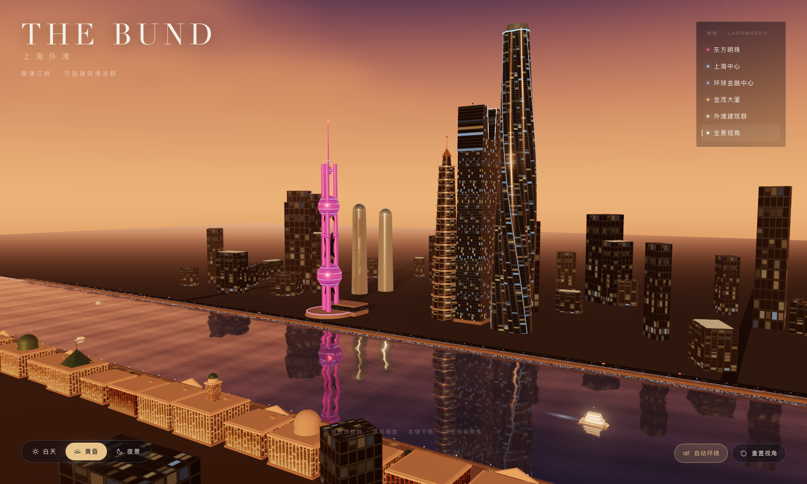

# 上海外滩 v1.0 · The Bund

> 这是最初的直线河道版本，作为存档保留。采用 U 形江湾与陆家嘴半岛布局的新版见
> [`../上海外滩v2.0`](../上海外滩v2.0/)。

一个完全程序化生成、可交互的 Three.js 3D 城市景观。以黄浦江为轴，两岸铺开
东方明珠、上海中心、环球金融中心、金茂大厦与万国建筑博览群，并支持白天、
黄昏、夜景三种时间状态。



## 快速开始

环境要求：Node.js ≥ 20.19，支持 WebGL 2 的桌面浏览器。

```bash
cd material/上海外滩v1.0

npm install
npm run dev
```

打开终端里提示的地址（默认 <http://localhost:5173>）。

生产构建与本地预览：

```bash
npm run build
npm run preview
```

构建产物在 `dist/`，使用相对路径，可部署到任意静态服务器或子目录。

## 交互方式

| 操作 | 效果 |
| --- | --- |
| 左键拖拽 | 旋转视角 |
| 滚轮 / 双指 | 缩放 |
| 右键拖拽 / 双指拖动 | 平移 |
| 右上角地标列表 | 飞行到东方明珠、上海中心、环球金融中心、金茂大厦、外滩建筑群 |
| 底部时间切换 | 白天 / 黄昏 / 夜景（1.9 秒平滑过渡） |
| 自动环绕 | 开启或关闭自动环绕镜头 |
| 重置视角 | 回到全景机位 |
| 键盘 `1` `2` `3` | 切换时间 |
| 键盘 `Space` | 自动环绕开关 |
| 键盘 `R` | 重置视角 |

## 场景内容

- **东方明珠**：三根立柱、三个球体、斜撑、观光层、天线与航空灯，夜间颜色缓慢流转。
- **上海中心**：120° 扭转的三叶圆角截面，程序化逐环放样，带螺旋灯缝与发光冠部。
- **环球金融中心**：用参数化 U 形轮廓挤出“开瓶器”顶部，开口边缘带冷光灯带。
- **金茂大厦**：12 层逐层收分的八角形塔身、金色腰带、塔尖与航空灯。
- **外滩建筑群**：16 栋历史建筑，包含柱廊、山花、穹顶、绿色铜皮屋顶与海关钟楼，
  配滨江步道、石铺地面、行道树、栏杆与路灯。
- **黄浦江**：真实平面反射 + 自定义水面着色器，包含菲涅尔、波光、夜间灯影与岸边泡沫。
- **城市动态**：游船与尾流、双向车流与头尾灯、南浦大桥缆索与桥灯、背景高楼群。
- **昼夜系统**：天空、太阳、半球光、雾、曝光、泛光、水面参数与所有建筑窗灯统一插值。

## 技术要点

- Three.js r186 + Vite。
- 全部几何、贴图、环境贴图均由代码或 Canvas 程序化生成，不依赖任何外部模型、图片或付费资源。
- PBR 材质（`MeshStandardMaterial`），程序化窗格 albedo + emissive 贴图。
- 平面反射使用 `three/addons/objects/Reflector.js` 的自定义 shader 扩展，反射分辨率独立于主画面。
- 后处理：`EffectComposer` → `RenderPass` → `UnrealBloomPass` → `OutputPass`，
  MSAA 4× 半浮点缓冲；泛光参数随时间状态插值。
- 阴影：单主方向光 + 2048² PCF 阴影贴图，仅在太阳移动时重绘。
- 性能：背景楼群、树木、路灯、车辆、栏杆等使用 `InstancedMesh`；合并/复用材质与贴图；
  像素比上限 1.6；高 DPI 下约 60fps（Apple Silicon + Chrome 实测）。

## 项目结构

```
上海外滩/
├── index.html              # 页面骨架与 UI
├── vite.config.js
├── src/
│   ├── main.js             # 渲染器、相机、控制器、后期、主循环
│   ├── config.js           # 场景尺度、地标机位、昼夜预设
│   ├── style.css           # HUD 样式
│   ├── ui.js               # 时间/地标/环绕/快捷键
│   ├── utils/
│   │   └── textures.js     # 立面、环境、光晕等程序化贴图
│   └── world/
│       ├── index.js        # 场景装配、灯光与更新入口
│       ├── materials.js    # PBR 材质与发光材质注册表
│       ├── sky.js          # 渐变天空、太阳、云、星空
│       ├── water.js        # 黄浦江反射水面
│       ├── time.js         # 昼夜插值系统
│       ├── towers.js       # 四座地标 + 浦东/浦西背景楼群
│       ├── bund.js         # 外滩历史建筑、步道、树与灯
│       ├── city.js         # 地面、道路、车流、南浦大桥
│       └── boats.js        # 游船与尾流
└── preview.png
```

## 性能与兼容性

- 推荐使用最新版 Chrome / Edge / Firefox / Safari 桌面浏览器，并开启硬件加速。
- 场景依赖 WebGL 2；不支持时会显示友好提示。
- 若在集成显卡上帧率不足，可在 `src/main.js` 中把
  `Math.min(window.devicePixelRatio, 1.6)` 调整为 `1.2`，
  或降低 `src/world/water.js` 中的反射纹理尺寸。

## 授权

代码可直接用于学习与二次创作。Three.js 采用 MIT 许可。
