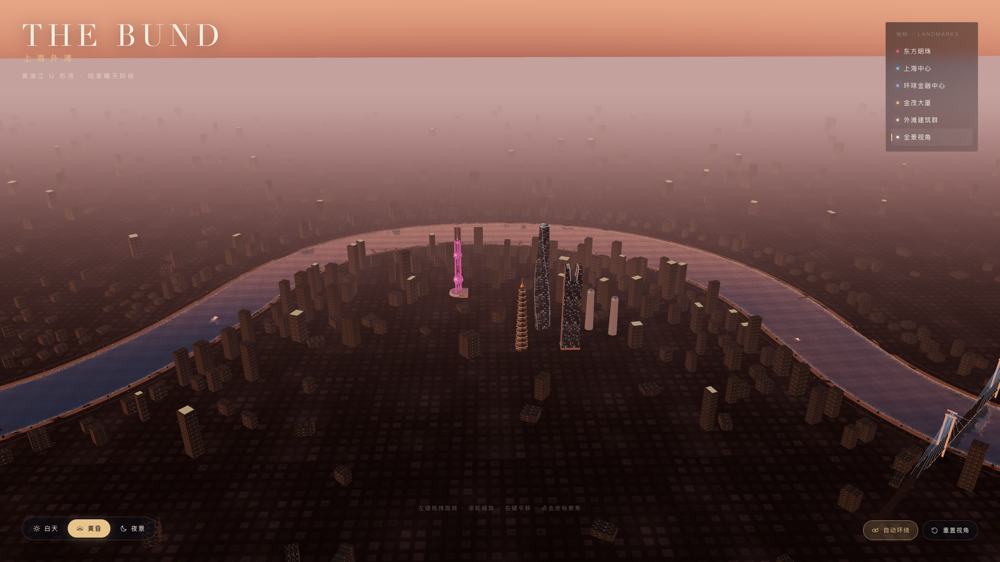
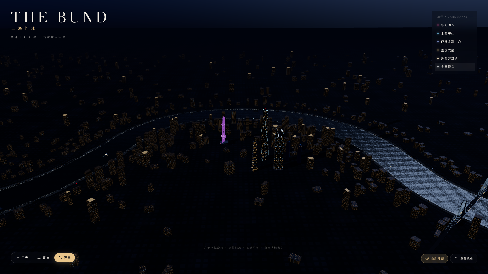
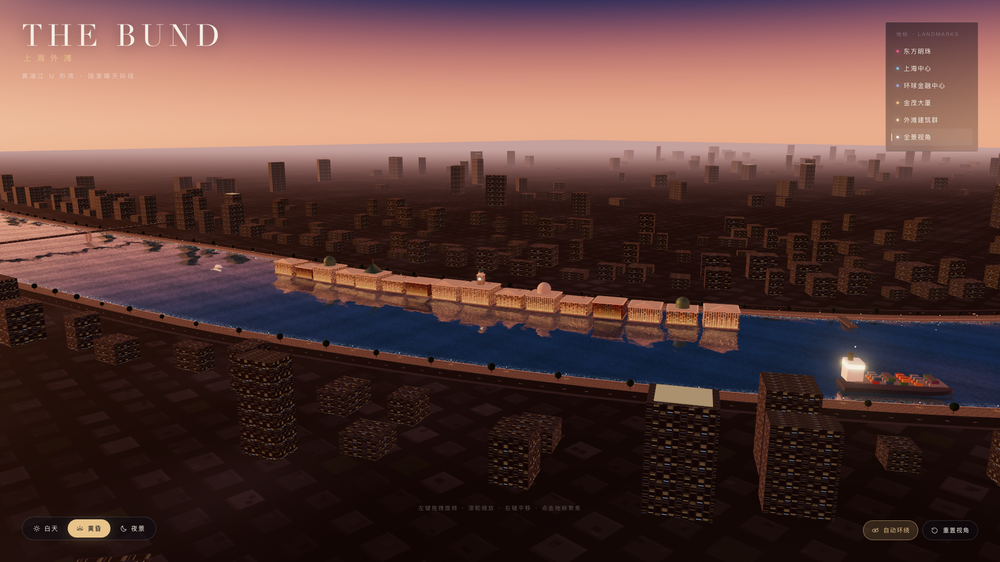

# 上海外滩 v2.0 · The Bund

一个完全程序化生成、可交互的 Three.js 3D 城市景观。

这一版的核心是**真实地理空间关系**：黄浦江不再是直线，而是一条从西南流入、
向北绕出大尺度 U 形弯道、再向东南流出的蜿蜒河道；陆家嘴位于弯道内侧的半岛上，
河流在三个方向环抱城市。东方明珠、上海中心、环球金融中心、金茂大厦坐落于半岛核心，
两岸的建筑、道路、滨江步道、码头与桥梁都沿同一条河道中心线展开。



## 更多视角

黄昏全景之外的夜景与外滩近景：





## v2.0 与 v1.0 的差异

| | v1.0 | v2.0 |
| --- | --- | --- |
| 河道 | 沿 Z 轴的直线河道 | `CatmullRomCurve3` 中心线生成的大尺度 U 形弯道 |
| 河岸 | 两条直线岸墙 | 沿曲线偏移生成、宽度随河道变化的连续岸线 |
| 水面 | 矩形平面 | 沿河道的连续 ribbon 网格，岸边泡沫随岸线变化 |
| 陆地 | 两块大平面 | 带河道孔洞的连续地块，道路 / 步道 / 建筑共享河岸坐标 |
| 城市 | 以直线路网布置 | 建筑、道路、车辆、树木、路灯、码头都沿河岸曲线延伸 |
| 船 | 沿 Z 轴往返 | 沿河道中心线的不同航线连续航行，自动跟随弯道转弯 |
| 镜头 | 平直滨江视角 | 高空斜俯视，完整展示 U 形江湾与半岛 |
| 新增 | — | 货轮、两座跨江桥、码头上盖、远景城市、城市底图纹理 |

原来的直线版本保留在 `material/上海外滩v1.0/`。

## 快速开始

环境要求：Node.js ≥ 20.19，支持 WebGL 2 的桌面浏览器。

```bash
cd material/上海外滩v2.0

npm install
npm run dev
```

打开终端里提示的地址（默认 <http://localhost:5173>）。

生产构建与本地预览：

```bash
npm run build
npm run preview
```

构建产物在 `dist/`，使用相对路径，可部署到任意静态服务器或子目录。

## 影片模式与视频导出

页面左上角点击「观看影片」，或直接打开 `?film=1`，会播放 28 秒的固定镜头版本：
四个镜头从 U 形江湾俯冲进入外滩立面，再环绕陆家嘴四塔，在镜头内完成黄昏到夜景的
过渡，最后回到外滩夜色。影片模式隐藏交互 UI，使用同一套配色与字体，播放结束后
淡出循环。

逐帧导出 2K / 60fps MP4 需要本机 Chrome 与 ffmpeg：

```bash
npm run dev -- --port 5188 --strictPort
# 另开终端
npm run export:film -- --frames deliverables/frames --fps 60 --duration 28
npm run encode:film -- --frames deliverables/frames \
  --out deliverables/shanghai-bund-v2-2k60-silent.mp4
npm run stills:film -- --out deliverables/previews
```

配乐版：`deliverables/shanghai-bund-v2-score.wav` 是由 `scripts/compose-score.py`
用 numpy / scipy 合成的原创配乐（无采样、无外部音乐素材），再以 AAC 320 kbps
封装进视频；视频流直接 copy，不重编码。完整母带与封装命令见
`deliverables/REPORT.md` 第 6 节。网页 `?film=1` 是静音预览，MP4 成片带配乐。

`?capture=1` 会关闭实时循环，以固定 1/60 秒步长推进时间线，并用固定 seed 覆盖
`Math.random`；相机、昼夜、文字全部由绝对时间推导，因此每次导出的帧序列一致。
镜头表、切点和字幕时间在 `src/film.js`，文案与版式在 `index.html` 与 `src/style.css`
的 `.film-*` 规则中。

## 交互方式

| 操作 | 效果 |
| --- | --- |
| 左键拖拽 | 旋转视角 |
| 滚轮 / 双指 | 缩放 |
| 右键拖拽 / 双指拖动 | 平移 |
| 右上角地标列表 | 飞行到东方明珠、上海中心、环球金融中心、金茂大厦、外滩建筑群 |
| 底部时间切换 | 白天 / 黄昏 / 夜景（1.9 秒平滑过渡） |
| 自动环绕 | 开启或关闭自动环绕镜头 |
| 重置视角 | 回到 U 形江湾全景机位 |
| 键盘 `1` `2` `3` | 切换时间 |
| 键盘 `Space` | 自动环绕开关 |
| 键盘 `R` | 重置视角 |

## 场景内容

- **黄浦江 U 形弯道**：一条 `CatmullRomCurve3` 中心线贯穿约 20 km，河宽在
  390–620 m 之间缓慢变化；急弯处自动收窄，避免两岸几何自交。河道从左前方远处
  流入，绕过陆家嘴后向右前方远处流出。
- **陆家嘴半岛**：位于弯道内侧，被江水三面环绕；四座地标位于半岛核心，
  周边是连续的高层建筑簇。
- **东方明珠**：三根立柱、三个球体、斜撑、观光层、天线与航空灯，夜间颜色缓慢流转。
- **上海中心**：120° 扭转的三叶圆角截面，程序化逐环放样，带螺旋灯缝与发光冠部。
- **环球金融中心**：参数化 U 形轮廓挤出“开瓶器”顶部，开口边缘带冷光灯带。
- **金茂大厦**：12 层逐层收分的八角形塔身、金色腰带、塔尖与航空灯。
- **外滩建筑群**：16 栋历史建筑，沿浦西一侧岸线逐栋排布并朝向江面，
  包含柱廊、山花、穹顶、绿色铜皮屋顶与海关钟楼，配夜间暖色泛光。
- **滨江空间**：双向四车道滨江道路、连续步道、防汛墙、栏杆压顶、行道树、
  沿江路灯、9 座伸入江面的码头与 2 座跨江桥（斜拉桥 + 梁桥）。
- **黄浦江水面**：真实平面反射 + 自定义水面着色器，包含菲涅尔、波光、
  夜间灯影、贴岸泡沫与日光碎金；水面网格沿河道生成。
- **城市动态**：6 艘游船 + 2 艘货轮沿河道分航线航行并自动转向，带尾流；
  道路上有双向车流、头尾灯；码头与桥面有灯光。
- **城市肌理**：程序化城市底图（街区、屋顶、绿化、街道）+ 约 900 栋
  实例化建筑，沿两岸连续展开并向外围渐次降低。
- **昼夜系统**：天空、太阳、半球光、雾、曝光、泛光、水面参数与所有建筑窗灯统一插值。

## 技术要点

- Three.js r186 + Vite，全部几何、贴图、环境贴图均由代码或 Canvas 程序化生成。
- **河道中枢** `src/world/river.js`：
  - 中心线按弧长均匀采样 900 段，输出位置 / 切线 / 法线 / 半宽；
  - 根据曲率自动限制河宽并做平滑，保证偏移岸线不自交；
  - 提供 `pointAt`、`bankPoint`、`lanePoint`、`nearest`、`isLand` 等查询；
  - 提供 `createRibbonGeometry` / `createBankWallGeometry`，供步道、道路、
    护岸、压顶等所有沿江构件复用。
- **带孔地块**：用 `ShapeGeometry` + `Path` 生成一整块陆地，河道作为孔洞；
  孔洞由左右岸线闭合而成，避免水面与地面穿插。
- **水面**：沿河道生成连续 ribbon（局部 XY 平面），交给 `Reflector` 做平面反射；
  shader 额外使用逐顶点 `aEdge` 属性绘制贴岸泡沫。
- PBR 材质（`MeshStandardMaterial`），程序化窗格 albedo + emissive 贴图；
  远景建筑按高度分为 3 个实例化批次，分别控制窗格密度。
- 后处理：`EffectComposer` → `RenderPass` → `UnrealBloomPass` → `OutputPass`，
  MSAA 4× 半浮点缓冲；泛光参数随时间状态插值。
- 阴影：单主方向光 + 2048² PCF 阴影贴图，覆盖陆家嘴与外滩一侧的江湾核心区，
  仅在太阳移动时重绘。
- 性能：建筑、树木、路灯、车辆、栏杆、桥灯等使用 `InstancedMesh`；
  共享材质与贴图；像素比上限 1.6。

## 项目结构

```
上海外滩v2.0/
├── index.html              # 页面骨架与 UI
├── vite.config.js
├── preview.png
├── src/
│   ├── main.js             # 渲染器、相机、控制器、后期、主循环
│   ├── config.js           # 河道控制点、地标位置、机位、昼夜预设
│   ├── style.css
│   ├── ui.js
│   ├── utils/
│   │   └── textures.js     # 立面、环境、光晕等程序化贴图
│   └── world/
│       ├── index.js        # 场景装配、灯光与更新入口
│       ├── river.js        # 河道中心线、岸线、ribbon / 护岸几何
│       ├── water.js        # 沿河道的反射水面
│       ├── city.js         # 地块、岸墙、步道、道路、车流、桥、码头、路灯、树
│       ├── bund.js         # 沿曲线排布的外滩历史建筑
│       ├── towers.js       # 四座地标 + 沿江 / 远景城市
│       ├── boats.js        # 游船、货轮与尾流
│       ├── sky.js          # 渐变天空、太阳、云、星空
│       ├── materials.js    # PBR / 发光材质注册表
│       └── time.js         # 昼夜插值系统
```

> 说明：陆地与滨江基础设施集中在 `city.js`，`river.js` 只提供几何与查询。

## 性能与兼容性

- 推荐使用最新版 Chrome / Edge / Firefox / Safari 桌面浏览器，并开启硬件加速。
- 场景依赖 WebGL 2；不支持时会显示友好提示。
- 若在集成显卡上帧率不足，可在 `src/main.js` 中把
  `Math.min(window.devicePixelRatio, 1.6)` 调整为 `1.2`，
  或降低 `src/world/water.js` 中的反射纹理尺寸。
- 远景城市使用实例化几何，阴影只覆盖核心区，因此扩大城市范围不会线性增加绘制开销。

## 授权

代码可直接用于学习与二次创作。Three.js 采用 MIT 许可。
