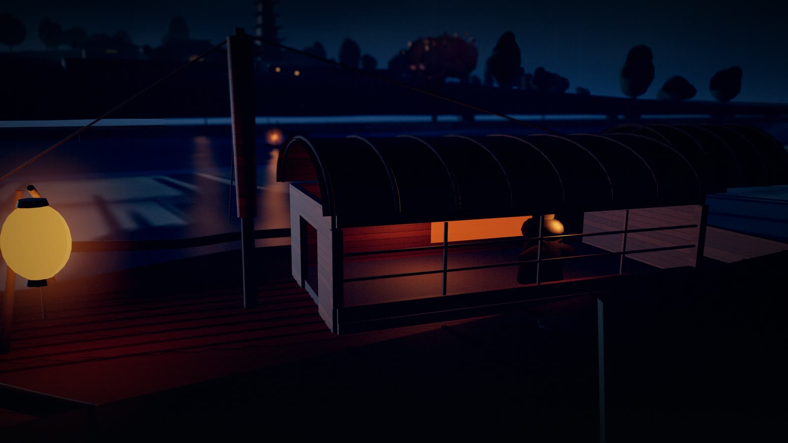

# 枫桥夜泊 · 沉浸式三维诗词动画

> 月落乌啼霜满天，江枫渔火对愁眠。  
> 姑苏城外寒山寺，夜半钟声到客船。  
> —— 唐 · 张继

一个完全程序化生成的 Three.js 江南深秋夜景：石拱枫桥、江岸枫林、停泊的唐代客船、
江上的渔船灯火、对岸雾中的寒山寺，以及一口在夜半撞响的古钟。

场景可自由漫游，也内置一支 **40 秒、60 fps 的电影短片**。所有几何、贴图、天空、
水面、雾气、粒子和声音都由代码生成，不依赖任何外部模型、图片或音频素材。



## 成片

- `deliverables/fengqiao-yebo-2k60.mp4` — 2560×1440 / 60 fps / 40.0 s / H.264 High + AAC，约 188 MiB，响度 -18 LUFS。
- `deliverables/fengqiao-yebo-2k60-heygen.mp4` — HeyGen 曲库古琴配乐版，画内钟声 / 鸦鸣 / 水风保留，响度 -18 LUFS。
- `deliverables/fengqiao-yebo-2k60-silent.mp4` — 无声备份，供重新配乐。
- `deliverables/previews/` — 七张关键镜头截图（2K PNG）与生产页截图。
- `deliverables/frames/` — 2400 帧 JPEG 序列（可用 `--resume` 续传）。

## 运行

要求 Node.js ≥ 20.19，以及支持 WebGL 2 的桌面浏览器。

```bash
cd material/枫桥夜泊

npm install
npm run dev        # http://localhost:5173
npm run build      # 产物输出到 dist/，base 为 "./"
npm run preview    # 本地预览构建产物
```

## 交互

| 操作 | 说明 |
| --- | --- |
| 拖拽 / 滚轮 / 右键拖拽 | 旋转、缩放、平移；首次操作会暂停影片并进入自由探索 |
| 空格 | 播放 / 暂停影片 |
| 1 – 6 | 全景、枫桥、江枫、客船、寒山寺、江面 |
| R | 重置视角 |
| 底部时间轴 | 拖到任意镜头；松开后保持暂停，按播放继续 |
| 雾气 / 字幕 / 声音 | 独立开关；声音默认关闭，需点击开启（浏览器自动播放策略） |

默认进入自动演示模式，从开场一路播放到片尾并循环。点击“观看影片”进入纯净的
40 秒影片页（`?film=1`），隐藏交互界面，只保留字幕、返回与声音开关。

## 镜头时间线

| 时间 | 镜头 | 字幕 |
| --- | --- | --- |
| 0 – 7 s | 高空俯视，月落江天，乌鸦掠过 | 月落乌啼霜满天 |
| 7 – 16 s | 下降掠过枫林与渔火，靠近客船 | 江枫渔火对愁眠 |
| 16 – 26 s | 从客船望向对岸，寒山寺自雾中显现 | 姑苏城外寒山寺 |
| 26 – 35 s | 推进钟楼，古钟摆动、撞响，声波越过江面 | 夜半钟声到客船 |
| 35 – 40 s | 黑场切回客船，拉远，完整诗篇与淡出 | 全诗 |

35 秒处的黑场是刻意的转场，遮住钟楼到客船的切镜。

## 场景构成

- **河道与江岸**：沿 X 轴的河道，南岸是枫桥、枫林、石阶、木码头与系船桩；
  北岸抬升为寒山寺所在的山坡；更远处是三层被夜雾吃掉的山脊。
- **枫桥**：单孔石拱桥。拱圈由自定义 BufferGeometry 沿弧线放样，桥面由逐块
  旋转、微错位的石板拼成，望柱与栏杆逐段生成。
- **枫树**：递归生成的枝干树形，叶簇与带枫叶剪影的叶片卡片全部实例化；
  顶点着色器负责风中的轻微摇动，另有 120 片独立模拟的落叶，会落到江面漂浮。
- **客船**：逐站截面放样的船体、木舱、竹篷、桅杆、收帆、缆绳与船头灯笼；
  舱内暖光与窗棂后的诗人剪影；船体随水流横摇、升沉。
- **寒山寺**：山门、主殿、偏殿、钟楼、五层塔与院墙；所有屋面共用一套
  带飞檐起翘的屋顶生成器。钟楼内是独立的青铜钟、撞木与钟摆动画。
- **水面**：`Reflector` 真实平面反射 + 自定义 shader，叠加多尺度波纹、
  菲涅尔、断续的月光碎影、渔火暖色倒影、贴岸泡沫与钟声涟漪。
- **雾与霜**：贴水的横向雾片、寺院前的雾团、极细的霜粒；不使用体积渲染。
- **声音**：Web Audio 程序化合成水声、风声、乌鸦与寺钟，与时间线同步。

### 技术亮点

- **水面**：`Reflector` 平面镜像 + 自定义 GLSL；月光不是贴图，而是根据相机、月亮方位与
  水面斜率实时计算的碎影；渔火倒影沿“相机 → 镜像光源”的连线拉长；钟声抵达时写入
  同心涟漪 uniform。
- **枫树**：递归枝干 + 全局实例化叶簇与叶片；顶点着色器按世界坐标施加风场；
  落叶是独立的 120 个实例，会落水、漂浮、再生成。
- **寺院屋面**：同一套屋顶生成器通过 `t` 参数控制屋脊、坡面曲率与四角起翘，
  主殿、偏殿、钟楼、山门、五层塔共用它，只改变尺寸与起翘量。
- **钟声**：撞木、钟摆、钟体微震、四道被噪声打散的环形波前、江面涟漪与雾团扰动，
  全部由绝对时间推导，可任意拖动时间轴而不破坏状态。
- **色调**：后处理链在 Bloom 之后加入冷暗部 / 暖高光的分离色调、轻提暗部、
  暗角与胶片颗粒，再交给 `OutputPass` 统一 tone mapping 与 sRGB 输出。

## 代码结构

```
src/
  main.js            渲染器、相机、后处理、模式切换、主循环
  config.js          色彩、水平基准、关键坐标、导航机位、月光方向
  film.js            40 秒时间线：相机关键帧、字幕、黑场转场
  ui.js              按钮、时间轴、开关的状态绑定
  audio.js           程序化 Web Audio（水/风/鸦/钟）
  deterministic.js   capture 模式下的固定随机种子
  world/
    index.js         装配场景、光照、雾、更新入口
    sky.js           深蓝夜空、落月、星、薄云
    water.js         Reflector + 江水 shader
    terrain.js       江岸、远山、护岸、码头、石阶、风灯
    bridge.js        单孔石拱桥
    trees.js         枫树、叶簇、叶片、落叶
    boat.js          唐代客船、诗人、灯笼、缆绳
    temple.js        寒山寺、钟楼、古钟、声波环
    fishing.js       渔船与渔火
    birds.js         乌鸦飞行与振翅
    mist.js          低空薄雾与霜粒
    materials.js     共享材质、程序化环境贴图
  utils/
    textures.js      木材、石材、瓦片、树皮、枫叶、雾、霜等 Canvas 贴图
scripts/
  export-film.mjs    逐帧导出 JPEG 序列
  encode-film.mjs    编码 2K / 60fps H.264
  capture-stills.mjs 关键镜头截图
  compose-score.py   40 秒程序化配乐
  compose-heygen-fx.py  HeyGen 配乐版的画内音层（水风 / 鸦鸣 / 寺钟）
  verify-build.mjs   构建产物回归
  test-interactions.mjs  交互回归
```

调试入口：`window.__fengqiao` 暴露 `renderer / scene / camera / controls / composer /
world / film / audio / flyTo / setView / setDemo` 等对象。

## 影片导出

在项目目录启动带固定端口的开发服务器：

```bash
npm run dev -- --port 5188 --strictPort
```

另开终端：

```bash
# 1. 逐帧捕获（2560×1440，60 fps，2400 帧）
npm run export:film -- --url http://127.0.0.1:5188/ --frames deliverables/frames

# 2. 编码无声视频
npm run encode:film -- --frames deliverables/frames \
  --out deliverables/fengqiao-yebo-2k60-silent.mp4

# 3. 合成 40 秒配乐
npm run score

# 4. 统一响度
ffmpeg -y -i deliverables/fengqiao-yebo-score-raw.wav \
  -af "loudnorm=I=-18:TP=-2:LRA=9,alimiter=limit=0.95" \
  -ar 48000 -ac 2 deliverables/fengqiao-yebo-score.wav

# 5. 封装音轨
ffmpeg -y -i deliverables/fengqiao-yebo-2k60-silent.mp4 \
  -i deliverables/fengqiao-yebo-score.wav \
  -c:v copy -c:a aac -b:a 192k -shortest -movflags +faststart \
  deliverables/fengqiao-yebo-2k60.mp4

# 6. 关键镜头截图
npm run stills:film -- --url http://127.0.0.1:5188/ \
  --out deliverables/previews
```

### HeyGen 重新配乐

不重新渲染画面，直接以无声成片为画面源，用 HeyGen 曲库中的古琴 / 箫曲替换程序化配乐，
并保留钟声、鸦鸣与水风等画内音：

```bash
# 1. 从 HeyGen 曲库检索并落地一首 40 秒左右的古风配乐
npx hyperframes media-use resolve --type bgm \
  --intent "traditional Chinese guqin and guzheng, melancholic night, \
moonlit river, temple bell, sparse cinematic underscore, slow, 40 seconds" \
  --project .

# 2. 渲染画内音层（两次寺钟、三声鸦鸣、水风铺底）
python3 scripts/compose-heygen-fx.py

# 3. 截取 40 秒、混音、统一响度到 -18 LUFS
ffmpeg -y -i .media/audio/bgm/bgm_001.wav \
  -i deliverables/fengqiao-yebo-heygen-fx.wav \
  -filter_complex "[0:a]atrim=0:40,aresample=48000,highpass=f=30,\
afade=t=in:st=0:d=0.8,afade=t=out:st=38:d=2[mus];\
[1:a]aresample=48000,volume=0.75[fx];\
[mus][fx]amix=inputs=2:duration=first:normalize=0[out]" \
  -map "[out]" -c:a pcm_f32le -ar 48000 deliverables/fengqiao-yebo-mix.wav

# 3b. loudnorm 两遍法：第一遍读取 measured_*，第二遍线性归一
ffmpeg -y -i deliverables/fengqiao-yebo-mix.wav \
  -af "loudnorm=I=-18:TP=-2:LRA=9:print_format=json" -f null -
ffmpeg -y -i deliverables/fengqiao-yebo-mix.wav \
  -af "loudnorm=I=-18:TP=-2:LRA=9:measured_I=<input_i>:\
measured_TP=<input_tp>:measured_LRA=<input_lra>:\
measured_thresh=<input_thresh>:offset=<target_offset>:linear=true" \
  -ar 48000 -c:a pcm_s16le deliverables/fengqiao-yebo-score-heygen.wav

# 4. 封装（视频流直接复制，不产生二次编码损失）
ffmpeg -y -i deliverables/fengqiao-yebo-2k60-silent.mp4 \
  -i deliverables/fengqiao-yebo-score-heygen.wav \
  -map 0:v:0 -map 1:a:0 -c:v copy -c:a aac -b:a 192k -ar 48000 -ac 2 \
  -shortest -movflags +faststart deliverables/fengqiao-yebo-2k60-heygen.mp4
```

捕获流程在 `?film=1&capture=1` 下以固定 1/60 秒步长推进，并用固定 seed 覆盖
`Math.random`，因此每次导出的帧序列一致。若中断，可加 `--resume` 续传。

`stills:film` 会从 0 秒重放以恢复所有时间相关状态；若已有导出的帧序列，也可以
直接从 `deliverables/frames` 提取对应帧（例如 1.6 s 对应 `f_00096.jpg`）。

实际导出规格记录在 [`deliverables/REPORT.md`](deliverables/REPORT.md)。

## 资源与许可

- 所有几何、贴图、环境贴图、天空、水面、粒子与声音均由本项目源码生成。
- 未使用任何外部 GLB / glTF 模型、图片、字体文件或音频采样。
- 中文排版使用系统衬线字体（Songti SC / STSong / SimSun / Noto Serif CJK SC）。
- Three.js 采用 MIT 许可；本项目代码可直接用于学习与二次创作。
