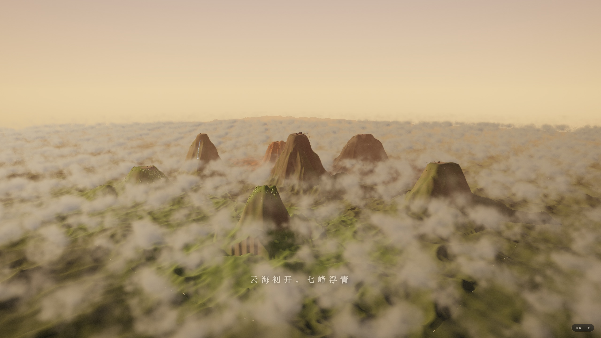

# 诛仙 · 青云山七峰

> 青云七峰，云海仙门。

一个完全程序化生成的 Three.js 仙侠山脉场景：七座主峰各自拥有独立的地貌、植被与山门建筑群，
体积云海漫过山谷，风回峰瀑布坠入云中，仙鹤绕峰飞行。场景可自由漫游，也内置一支
**36 秒、60 fps 的五镜头电影**。

所有几何、贴图、天空、云海、水面、植被、粒子和声音都由代码生成，不依赖任何外部模型、
图片或音频素材。



## 成片

- `deliverables/qingyun-seven-peaks-2k60.mp4` — 2560×1440 / 60 fps / 36.0 s / H.264 High + AAC，约 -18 LUFS。
- `deliverables/qingyun-seven-peaks-2k60-silent.mp4` — 无声备份，供重新配乐。
- `deliverables/previews/` — 七张关键镜头截图（2K PNG）。
- `deliverables/frames/` — 2160 帧 JPEG 序列（可用 `--resume` 续传）。
- `deliverables/REPORT.md` — 实际导出规格、渲染耗时与验收记录。

## 运行

要求 Node.js ≥ 20.19，以及支持 WebGL 2 的桌面浏览器。

```bash
cd material/诛仙青云山七峰

npm install
npm run dev        # http://localhost:5173
npm run build      # 产物输出到 dist/，base 为 "./"
npm run preview    # 本地预览构建产物
npm test           # 高度函数 / 建筑 / 植被 / 水体 / 影片时间线测试
```

## 交互

| 操作 | 说明 |
| --- | --- |
| 拖拽 / 滚轮 / 右键拖拽 | 旋转、缩放、平移；首次操作会暂停影片并进入自由探索 |
| 空格 | 播放 / 暂停影片 |
| 1 – 8 | 全景、通天、龙首、落霞、风回、大竹、小竹、朝阳 |
| R | 重置到全景 |
| 底部时间轴 | 拖到任意镜头；松开后保持暂停，按播放继续 |
| 云海 / 雾 / 字幕 / 声音 | 独立开关；声音默认关闭，需点击开启（浏览器自动播放策略） |

默认进入影片自动演示模式，从开场一路播放到片尾并循环。点击「观看影片」或访问
`?film=1` 进入纯净影片页，隐藏交互界面，只保留字幕、返回与声音开关。

## 镜头时间线

| 时间 | 镜头 | 字幕 |
| --- | --- | --- |
| 0 – 8 s | 高空全景，七峰自云海浮出 | 云海初开，七峰浮青 |
| 8 – 15 s | 掠向通天峰，俯瞰主殿群与百级玉阶 | 通天一径，玉阶凌云 |
| 15 – 22 s | 贴竹海滑行，大竹峰与小竹峰隔着云海对望 | 竹影摇风，双峰对望 |
| 22 – 29 s | 仰视风回峰瀑布，镜头升起越过龙首脊线 | 龙首垂瀑，风回千仞 |
| 29 – 36 s | 落霞峰逆光楼阁，拉远至七峰全景，片名淡出 | 落霞满袖，青云不老 |

切点处用 0.8 秒的穿云白场遮住镜头切换；片尾 1.5 秒淡出并显示「青云七峰 · 云海仙门」。

## 场景构成

- **七峰**：通天峰（0, 0，高 1790 m）居中，龙首、落霞、风回、大竹、小竹、朝阳环绕。
  谷地基准 420 m，七峰共享同一解析高度函数，峰间以鞍部与深谷相连。
- **地形**：唯一高度函数 `heightAt(x, z)` 驱动四级同心方环网格（近环 15 m、远环 120 m）。
  峰体由各向异性轮廓、角度脊线、域扭曲、中段悬崖带、卫星山脊与冲沟组成；
  峰顶压平成建筑台地，并做峰高标定避免「火山口」。
- **云海**：半分辨率 Ray Marching 体积云 Pass，读取场景深度做遮挡与软相交。
  谷地云海 740–1080 m，密度峰 900 m；山腰云带 1320 m（7% 密度）。
  太阳方向 3 次光照采样 + Henyey-Greenstein 相位，形成受光银边。
- **建筑**：参数化歇山屋顶（正脊、坡面曲率、四角起翘）、须弥座、柱列、斗拱、窗棂、
  栏杆、石阶、牌坊、亭、塔与桥。通天峰为 86×46 m 重檐主殿 + 配殿 + 后殿 + 玉阶。
- **植被**：大竹峰 12 800 竿、小竹峰 5 600 竿竹；1000 棵松；600 棵秋树（落霞峰）；
  3 200 簇草。竹竿与叶簇用 InstancedMesh，顶点着色器风摆。
- **水体**：风回峰瀑布（落差约 480 m）用滚动噪声水带 + 水雾粒子；大小竹峰山泉沿地形流下；
  瀑布下有小水潭与 `Reflector` 平面反射。
- **生灵**：四群仙鹤绕峰飞行，翅膀按绝对时间扇动。
- **光照**：黄金时刻向日落推进，太阳高度 22°→7°，色温由琥珀转向玫红；
  阴影相机跟随当前镜头焦点。

### 技术亮点

- **地形**：解析高度函数 + 方环网格，所有子系统共用同一地形真值；峰高迭代标定。
- **云海**：半分辨率 3D 噪声 Ray Marching，深度遮挡、软相交、太阳散射与两层高度分布。
- **建筑**：屋顶曲面由「正脊 + 脊外收坡 + 角部起翘」参数化生成，方亭自动改用金顶珠。
- **植被**：2.4 万竹竿/叶簇实例，共享风场 uniform；团簇式竹林分布。
- **影片**：五段独立 Catmull-Rom 机位曲线，穿云白场转场，所有状态由绝对时间推导，
  可任意拖动并逐帧确定性重放。
- **后处理**：`RenderPass → 体积云 → Bloom → Grade → OutputPass → SMAA`。

## 代码结构

```
src/
  main.js            渲染器、相机、后处理、模式切换、主循环
  config.js          七峰参数、色彩、太阳关键帧、机位
  filmTimeline.js    36 秒纯函数时间线：机位、字幕、转场
  film.js            影片播放器与 DOM 字幕
  ui.js              机位、播放、时间轴与开关
  audio.js           程序化 Web Audio（风 / 云海 / 瀑布 / 钟）
  deterministic.js   capture 模式固定随机种子
  world/
    index.js         装配场景与更新入口
    shape.js         解析高度函数、峰体参数与标定
    terrain.js       方环地形网格、顶点色与 AO
    clouds.js        体积云后处理 Pass
    sky.js           天空穹顶、太阳、雾与环境贴图
    buildings.js     中式建筑构件库
    peaks.js         七峰建筑群
    vegetation.js    竹海、松林、秋林、草簇
    water.js         瀑布、山泉、水潭
    mist.js          低空雾片
    birds.js         仙鹤
    materials.js     共享材质
  utils/
    noise.js         确定性随机、2D/3D 噪声
    textures.js      程序化 Canvas 贴图与 3D 云噪声
scripts/
  test-*.mjs         核心 / 建筑 / 植被 / 水体 / 影片 / 交互测试
  verify-scene.mjs   场景加载、resize 与运行时错误检查
  export-film.mjs    逐帧导出 JPEG 序列
  encode-film.mjs    编码 2K / 60fps H.264
  capture-stills.mjs 关键镜头截图
  compose-score.py   36 秒程序化配乐
```

调试入口：`window.__qingyun` 暴露 `renderer / scene / camera / controls / composer /
world / ui / film / audio / flyTo / setView / setDemo`；
`?film=1&capture=1` 下暴露 `window.__capture.renderAt(t)`。

## 影片导出

在项目目录启动带固定端口的开发服务器：

```bash
npm run dev -- --port 5199 --strictPort
```

另开终端：

```bash
# 1. 逐帧捕获（2560×1440，60 fps，2160 帧）
npm run export:film -- --url http://127.0.0.1:5199/ --frames deliverables/frames

# 2. 编码无声视频
npm run encode:film -- --frames deliverables/frames \
  --out deliverables/qingyun-seven-peaks-2k60-silent.mp4

# 3. 合成 36 秒配乐
python3 scripts/compose-score.py
ffmpeg -y -i deliverables/qingyun-score-raw.wav \
  -af "loudnorm=I=-18:TP=-2:LRA=9" -ar 48000 -ac 2 \
  deliverables/qingyun-score.wav

# 4. 封装音轨（视频流直接复制）
ffmpeg -y -i deliverables/qingyun-seven-peaks-2k60-silent.mp4 \
  -i deliverables/qingyun-score.wav \
  -map 0:v:0 -map 1:a:0 -c:v copy -c:a aac -b:a 192k -ar 48000 -ac 2 \
  -shortest -movflags +faststart deliverables/qingyun-seven-peaks-2k60.mp4

# 5. 关键镜头截图
npm run stills:film -- --url http://127.0.0.1:5199/ --out deliverables/previews
```

捕获流程在 `?film=1&capture=1` 下以固定 1/60 秒步长推进，并用固定 seed 覆盖
`Math.random`，因此每次导出的帧序列一致。若中断，可加 `--resume` 续传。

## 资源与许可

- 所有几何、贴图、环境贴图、天空、云海、水面、粒子与声音均由本项目源码生成。
- 未使用任何外部 GLB / glTF 模型、图片、字体文件或音频采样。
- 中文排版使用系统衬线字体（Songti SC / STSong / SimSun / Noto Serif CJK SC）。
- Three.js 采用 MIT 许可；本项目代码可直接用于学习与二次创作。
